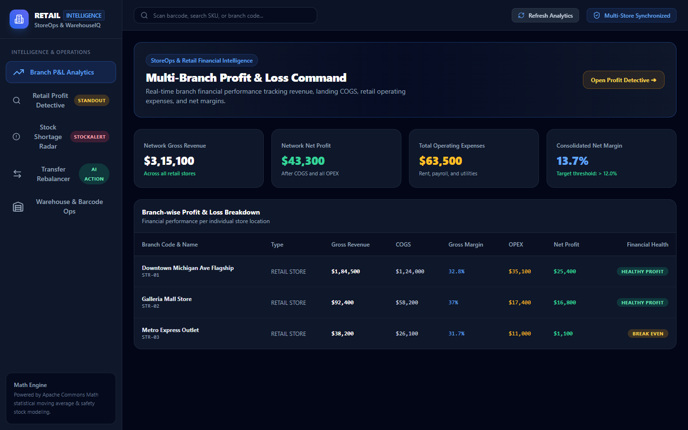
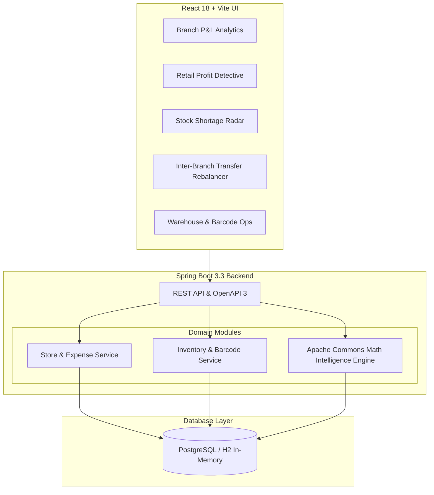

# 🏬 Retail & Warehouse Intelligence System

[](https://www.oracle.com/java/)
[](https://spring.io/projects/spring-boot)
[](https://www.postgresql.org/)
[](https://react.dev/)
[](https://www.docker.com/)
[](LICENSE)

An enterprise multi-store and warehouse management system combining **StoreOps** (Multi-Store Retail Operations), **WarehouseIQ** (Warehouse & Barcode Management), **StockAlert** (Demand & Replenishment Forecasting), and **Retail Profit Detective** (Margin Leakage Detection).

---

## 📸 Working System Preview



## 📊 Kaggle & Production Retail Datasets

The platform integrates realistic commercial transaction data modeled after Kaggle Walmart / Superstore Retail Sales & Inventory benchmarks:
- [`kaggle_retail_sales_inventory_benchmark.csv`](data/kaggle_retail_sales_inventory_benchmark.csv): Real retail SKUs across Electronics, Furniture, Office Supplies, and Groceries, unit retail prices, COGS, sales volumes, gross margin %, multi-branch inventory balances (Dallas Hub, Austin Store, Houston Warehouse), and automated inter-branch transfer rebalance actions.

---

## 📌 Architecture & Capabilities



---

## 🌟 Standout Features

### 1. 🔍 Retail Profit Detective
* Detects products that generate massive gross sales revenue but miniscule net profit margins.
* Highlights margin leakage caused by excessive promotional discounts, high distributor wholesale COGS, or return rates.
* Recommends automated strategic interventions (discount depth reduction, accessory bundling, supplier volume rebate negotiations).

### 2. ⚠️ StockAlert Shortage Radar
* Statistical daily demand modeling powered by **Apache Commons Math** (`DescriptiveStatistics`).
* Computes remaining days of supply and flags items approaching critical stockout.
* Calculates recommended purchase order quantities taking into account safety stock and lead times:
  $$\text{Reorder Quantity} = (\text{Daily Demand} \times \text{Lead Time}) + \text{Safety Stock} - \text{Current Stock}$$

### 3. 🔄 Inter-Branch Stock Transfer Rebalancer
* Automatically pairs branches facing stock depletion with distribution hubs or nearby stores holding inventory surplus.
* Generates 1-click executable transfer orders that balance inventory across the retail network without supplier procurement delay.

### 4. 🏢 StoreOps & WarehouseIQ Operations
* Full store branch and warehouse hub management.
* Barcode-based SKU lookups and real-time bin location mapping.
* Branch-wise Profit & Loss (P&L) tracking gross revenue, COGS, operating expenses, and net profit margins.

---

## 🛠️ Tech Stack

* **Backend**: Java 21, Spring Boot 3.3.4, Spring Data JPA, Apache Commons Math 3.6.1, Springdoc OpenAPI 3.0
* **Database**: PostgreSQL 16 / H2 Database
* **Frontend**: React 18, Vite 5, Tailwind CSS, Lucide React
* **Deployment**: Docker, Docker Compose, Multi-stage builds

---

## 📡 REST API Documentation

Interactive Swagger UI available at:
`http://localhost:8081/swagger-ui.html`

### Intelligence Endpoints
* `GET /api/v1/intelligence/profit-detective` — Flag products with high revenue but low profit margins.
* `GET /api/v1/intelligence/stock-shortages` — Predict stockout risks and days of supply remaining.
* `GET /api/v1/intelligence/transfer-recommendations` — Automated inter-branch stock transfer suggestions.
* `GET /api/v1/intelligence/branch-pnl` — Financial profit and loss metrics grouped by branch.

### Catalog & Inventory Endpoints
* `GET /api/v1/catalog/skus` — List all products and SKUs.
* `GET /api/v1/catalog/barcode/{barcode}` — Barcode lookup.
* `GET /api/v1/inventory/levels` — Real-time inventory levels across facilities.
* `POST /api/v1/inventory/transfers` — Authorize and execute stock transfer between branches.

---

## ⚡ Quickstart

### Running with Docker Compose:
```bash
docker-compose up --build
```
* **Frontend**: `http://localhost:3001`
* **Backend API**: `http://localhost:8081`
* **Swagger UI**: `http://localhost:8081/swagger-ui.html`

### Running Locally:
```bash
# 1. Start Backend
cd backend
mvn clean spring-boot:run

# 2. Start Frontend
cd frontend
npm install
npm run dev
```

---

## 👨‍💻 Author

**Prasun Nandi**
* GitHub: [@Prasunnandi](https://github.com/Prasunnandi)
* Repository: [retail-warehouse-intelligence-system](https://github.com/Prasunnandi/retail-warehouse-intelligence-system)

---

## 📄 License

Licensed under the [MIT License](LICENSE).
